# Ordo – lebende Roadmap

<!-- Erzeugt von utils/roadmap.sh. Nicht von Hand ändern: Ziele stehen im Skript, erledigt ist, was sein Prüfbefehl bestätigt. -->

Stand: 16.11.2026, letzte Version: v0.11.1. Als Nächstes: **Musik-Player: Audio direkt in Ordo abspielen**

Jedes Ziel ist eine Zelle mit einem Prüfbefehl ([autopoiesis](https://github.com/BEKO2210/autopoiesis)).
Besteht der Befehl, ist das Ziel erledigt. Nach jeder veröffentlichten Version entstehen die Zellen
für die nächste – vor 1.0.0 und danach.

## Offen

- [ ] KI-Tempo auf echten Geräten gemessen
- [ ] Zwei Spalten auf Tablets
- [ ] Geschlossener Test bei Google Play bestanden
- [ ] Version 1.0.0 im Play Store
- [ ] KI-Vorschau mit eigenen Sätzen aus dem Alltag geprüft
- [ ] Musik-Player: Audio direkt in Ordo abspielen
- [ ] Musik-Player als eigenes App-Symbol zum Einschalten
- [ ] Video-Player: Filme direkt in Ordo ansehen
- [ ] PDF-Leser: suchen, markieren, Nachtmodus
- [ ] Markdown lesen und schreiben
- [ ] Bildbetrachter auf Spitzenniveau
- [ ] PDF bearbeiten: markieren, kommentieren, Formulare, Seiten ordnen
- [ ] Jede gängige Datei öffnen, lesen und schreiben – und es sieht gut aus
- [ ] Eingebaute Apps entkoppeln: jede als eigenes App-Symbol, einzeln schaltbar
- [ ] Dokumente bearbeiten: Entscheidung für Office-Formate
- [ ] Nach v0.11.1: nächste Version hat eine eigene Nummer
- [ ] Nach v0.11.1: beide READMEs nennen die neue Version
- [ ] Nach v0.11.1: neue Version veröffentlicht

## Erledigt

- [x] Analyse neu: Belegung, Rangliste, Seiten statt Reiter
- [x] Analyse: Diagramme zurück, fehlerfrei und antippbar
- [x] Analyse: Scan-Animation statt Ladekreisel
- [x] KI wählt das Modell passend zum Gerät
- [x] Datenmüll finden: leere Ordner und Vorschau-Caches
- [x] Sicherung wiederherstellen per Knopf
- [x] Name endgültig
- [x] Store-Texte Deutsch und Englisch
- [x] Store-Bilder im Repo
- [x] Berechtigungen für Google Play begründet
- [x] Vordergrunddienst-Typ für Dateiaufträge geklärt
- [x] Native Bibliothek für 16-KB-Seiten
- [x] KI: neue Befehle als Vorschau zum Einschalten
- [x] KI-Blatt lesbar ohne Unschärfe-Effekt
- [x] Einstellungen bildlich: Symbol an jedem Eintrag, Auswahl mit Bildern
- [x] Bewegung aus einem Guss: Menüs, Dialoge, Piktogramme
- [x] Stand der Technik für Medien belegt

## Graph

```mermaid
flowchart TD
  nc_ede36f["Analyse neu: Belegung, Rangliste, Seiten statt Reiter [done]"]
  nc_dcb31f["Analyse: Diagramme zurück, fehlerfrei und antippbar [done]"]
  nc_705605["Analyse: Scan-Animation statt Ladekreisel [done]"]
  nc_bbb839["KI wählt das Modell passend zum Gerät [done]"]
  nc_dbb367["KI-Tempo auf echten Geräten gemessen [active]"]
  nc_979ee9["Datenmüll finden: leere Ordner und Vorschau-Caches [done]"]
  nc_b5a363["Sicherung wiederherstellen per Knopf [done]"]
  nc_c185a5["Zwei Spalten auf Tablets [active]"]
  nc_655851["Name endgültig [done]"]
  nc_7f8703["Store-Texte Deutsch und Englisch [done]"]
  nc_fbbaf5["Store-Bilder im Repo [done]"]
  nc_3a43c7["Berechtigungen für Google Play begründet [done]"]
  nc_68c61a["Vordergrunddienst-Typ für Dateiaufträge geklärt [done]"]
  nc_5836f9["Native Bibliothek für 16-KB-Seiten [done]"]
  nc_885a63["Geschlossener Test bei Google Play bestanden [active]"]
  nc_7d443b["Version 1.0.0 im Play Store [active]"]
  nc_323a3e["KI: neue Befehle als Vorschau zum Einschalten [done]"]
  nc_42c1ba["KI-Vorschau mit eigenen Sätzen aus dem Alltag geprüft [active]"]
  nc_c6e078["KI-Blatt lesbar ohne Unschärfe-Effekt [done]"]
  nc_0ddbf7["Einstellungen bildlich: Symbol an jedem Eintrag, Auswahl mit Bildern [done]"]
  nc_55b86d["Bewegung aus einem Guss: Menüs, Dialoge, Piktogramme [done]"]
  nc_1057ad["Stand der Technik für Medien belegt [done]"]
  nc_a7dfe4["Musik-Player: Audio direkt in Ordo abspielen [active]"]
  nc_f3c3b7["Musik-Player als eigenes App-Symbol zum Einschalten [active]"]
  nc_e43d3c["Video-Player: Filme direkt in Ordo ansehen [active]"]
  nc_82fb80["PDF-Leser: suchen, markieren, Nachtmodus [active]"]
  nc_f8cb8a["Markdown lesen und schreiben [active]"]
  nc_15d081["Bildbetrachter auf Spitzenniveau [active]"]
  nc_da638c["PDF bearbeiten: markieren, kommentieren, Formulare, Seiten ordnen [active]"]
  nc_8094b1["Jede gängige Datei öffnen, lesen und schreiben – und es sieht gut aus [active]"]
  nc_02cd71["Eingebaute Apps entkoppeln: jede als eigenes App-Symbol, einzeln schaltbar [active]"]
  nc_06654e["Dokumente bearbeiten: Entscheidung für Office-Formate [active]"]
  nc_fb21a6["Nach v0.11.1: nächste Version hat eine eigene Nummer [active]"]
  nc_d1de03["Nach v0.11.1: beide READMEs nennen die neue Version [active]"]
  nc_765e65["Nach v0.11.1: neue Version veröffentlicht [active]"]
  nc_3a43c7 --> nc_885a63
  nc_5836f9 --> nc_885a63
  nc_68c61a --> nc_885a63
  nc_7f8703 --> nc_885a63
  nc_fbbaf5 --> nc_885a63
  nc_655851 --> nc_7d443b
  nc_885a63 --> nc_7d443b
  nc_323a3e --> nc_42c1ba
  nc_1057ad --> nc_a7dfe4
  nc_a7dfe4 --> nc_f3c3b7
  nc_1057ad --> nc_e43d3c
  nc_f3c3b7 --> nc_e43d3c
  nc_1057ad --> nc_82fb80
  nc_1057ad --> nc_f8cb8a
  nc_1057ad --> nc_15d081
  nc_82fb80 --> nc_da638c
  nc_f8cb8a --> nc_8094b1
  nc_e43d3c --> nc_02cd71
  nc_f3c3b7 --> nc_02cd71
  nc_f8cb8a --> nc_06654e
  nc_fb21a6 --> nc_d1de03
  nc_d1de03 --> nc_765e65
```

