# Ordo – lebende Roadmap

<!-- Erzeugt von utils/roadmap.sh. Nicht von Hand ändern: Ziele stehen im Skript, erledigt ist, was sein Prüfbefehl bestätigt. -->

Stand: 15.11.2026, letzte Version: v0.8.0. Als Nächstes: **Store-Bilder im Repo**

Jedes Ziel ist eine Zelle mit einem Prüfbefehl ([autopoiesis](https://github.com/BEKO2210/autopoiesis)).
Besteht der Befehl, ist das Ziel erledigt. Nach jeder veröffentlichten Version entstehen die Zellen
für die nächste – vor 1.0.0 und danach.

## Offen

- [ ] KI-Tempo auf echten Geräten gemessen
- [ ] Zwei Spalten auf Tablets
- [ ] Store-Bilder im Repo
- [ ] Geschlossener Test bei Google Play bestanden
- [ ] Version 1.0.0 im Play Store
- [ ] Nach v0.8.0: nächste Version hat eine eigene Nummer
- [ ] Nach v0.8.0: beide READMEs nennen die neue Version
- [ ] Nach v0.8.0: neue Version veröffentlicht

## Erledigt

- [x] Analyse neu: Belegung, Rangliste, Seiten statt Reiter
- [x] Analyse: Diagramme zurück, fehlerfrei und antippbar
- [x] Analyse: Scan-Animation statt Ladekreisel
- [x] KI wählt das Modell passend zum Gerät
- [x] Datenmüll finden: leere Ordner und Vorschau-Caches
- [x] Sicherung wiederherstellen per Knopf
- [x] Name endgültig
- [x] Store-Texte Deutsch und Englisch
- [x] Berechtigungen für Google Play begründet
- [x] Vordergrunddienst-Typ für Dateiaufträge geklärt
- [x] Native Bibliothek für 16-KB-Seiten

## Graph

```mermaid
flowchart TD
  nc_d8d1e6["Analyse neu: Belegung, Rangliste, Seiten statt Reiter [done]"]
  nc_b34ea0["Analyse: Diagramme zurück, fehlerfrei und antippbar [done]"]
  nc_a7e46a["Analyse: Scan-Animation statt Ladekreisel [done]"]
  nc_3ca643["KI wählt das Modell passend zum Gerät [done]"]
  nc_5d263f["KI-Tempo auf echten Geräten gemessen [active]"]
  nc_5313f7["Datenmüll finden: leere Ordner und Vorschau-Caches [done]"]
  nc_d31174["Sicherung wiederherstellen per Knopf [done]"]
  nc_46e96b["Zwei Spalten auf Tablets [active]"]
  nc_11631a["Name endgültig [done]"]
  nc_eac1f8["Store-Texte Deutsch und Englisch [done]"]
  nc_628ce2["Store-Bilder im Repo [active]"]
  nc_5281d8["Berechtigungen für Google Play begründet [done]"]
  nc_55e044["Vordergrunddienst-Typ für Dateiaufträge geklärt [done]"]
  nc_1fae9e["Native Bibliothek für 16-KB-Seiten [done]"]
  nc_fbe238["Geschlossener Test bei Google Play bestanden [active]"]
  nc_93bb53["Version 1.0.0 im Play Store [active]"]
  nc_9968e8["Nach v0.8.0: nächste Version hat eine eigene Nummer [active]"]
  nc_734cc7["Nach v0.8.0: beide READMEs nennen die neue Version [active]"]
  nc_dcc4f6["Nach v0.8.0: neue Version veröffentlicht [active]"]
  nc_1fae9e --> nc_fbe238
  nc_5281d8 --> nc_fbe238
  nc_55e044 --> nc_fbe238
  nc_628ce2 --> nc_fbe238
  nc_eac1f8 --> nc_fbe238
  nc_11631a --> nc_93bb53
  nc_fbe238 --> nc_93bb53
  nc_9968e8 --> nc_734cc7
  nc_734cc7 --> nc_dcc4f6
```

