# Ordo – lebende Roadmap

<!-- Erzeugt von utils/roadmap.sh. Nicht von Hand ändern: Ziele stehen im Skript, erledigt ist, was sein Prüfbefehl bestätigt. -->

Stand: 21.11.2026, letzte Version: v0.18.0. Als Nächstes: **PDF-Leser: suchen, markieren, Nachtmodus**

Jedes Ziel ist eine Zelle mit einem Prüfbefehl ([autopoiesis](https://github.com/BEKO2210/autopoiesis)).
Besteht der Befehl, ist das Ziel erledigt. Nach jeder veröffentlichten Version entstehen die Zellen
für die nächste – vor 1.0.0 und danach.

## Offen

- [ ] KI-Tempo auf echten Geräten gemessen
- [ ] Zwei Spalten auf Tablets
- [ ] Geschlossener Test bei Google Play bestanden
- [ ] Version 1.0.0 im Play Store
- [ ] KI-Vorschau mit eigenen Sätzen aus dem Alltag geprüft
- [ ] Streaming: Musik an Fernseher und Receiver per DLNA
- [ ] Streaming: Videos und Bilder an den Fernseher
- [ ] PDF-Leser: suchen, markieren, Nachtmodus
- [ ] Markdown lesen und schreiben
- [ ] Bildbetrachter auf Spitzenniveau
- [ ] PDF bearbeiten: markieren, kommentieren, Formulare, Seiten ordnen
- [ ] Jede gängige Datei öffnen, lesen und schreiben – und es sieht gut aus
- [ ] Goldener Schnitt als Maßsystem in ganz Ordo
- [ ] Dokumente bearbeiten: Entscheidung für Office-Formate
- [ ] KI: Musik per Satz abspielen (Datei-Manager und Ordo Musik)
- [ ] Offline-Chatbot, verbunden mit allen eingebauten Apps
- [ ] Nach v0.18.0: nächste Version hat eine eigene Nummer
- [ ] Nach v0.18.0: beide READMEs nennen die neue Version
- [ ] Nach v0.18.0: neue Version veröffentlicht

## Erledigt

- [x] Analyse neu: Belegung, Rangliste, Seiten statt Reiter
- [x] Analyse: Diagramme zurück, fehlerfrei und antippbar
- [x] Analyse: Scan-Animation statt Ladekreisel
- [x] KI wählt das Modell passend zum Gerät
- [x] Datenmüll finden: leere Ordner und Vorschau-Caches
- [x] Sicherung wiederherstellen per Knopf
- [x] Name endgültig
- [x] Store-Texte Deutsch und Englisch
- [x] Store-Bilder im Repo
- [x] Berechtigungen für Google Play begründet
- [x] Vordergrunddienst-Typ für Dateiaufträge geklärt
- [x] Native Bibliothek für 16-KB-Seiten
- [x] KI: neue Befehle als Vorschau zum Einschalten
- [x] KI-Blatt lesbar ohne Unschärfe-Effekt
- [x] Einstellungen bildlich: Symbol an jedem Eintrag, Auswahl mit Bildern
- [x] Bewegung aus einem Guss: Menüs, Dialoge, Piktogramme
- [x] Stand der Technik für Medien belegt
- [x] Musik-Player: Audio direkt in Ordo abspielen
- [x] Klang: eigene Effekte mit lebenden Bildern
- [x] Musik-Player als eigenes App-Symbol zum Einschalten
- [x] Ordo Musik: eigene Musiksammlung mit Titeln, Alben, Interpreten und Ordnern
- [x] Ordo Musik: Infos bearbeiten (Tag-Editor)
- [x] Ordo Musik: Auswahl, Wiedergabelisten und Favoriten
- [x] Video-Player: Filme direkt in Ordo ansehen
- [x] Abspielen auf: Bluetooth, Kabel und Cast-Geräte wählen
- [x] Streaming: Musik an Chromecast und Google TV
- [x] Eingebaute Apps entkoppeln: jede als eigenes App-Symbol, einzeln schaltbar
- [x] Icon-Farbe für Ordo und jede eingebaute App selbst wählen
- [x] Ordo als Ort in Androids Dateiauswahl (DocumentsProvider)

## Graph

```mermaid
flowchart TD
  nc_7f4db0["Analyse neu: Belegung, Rangliste, Seiten statt Reiter [done]"]
  nc_c40366["Analyse: Diagramme zurück, fehlerfrei und antippbar [done]"]
  nc_38cacb["Analyse: Scan-Animation statt Ladekreisel [done]"]
  nc_0492cd["KI wählt das Modell passend zum Gerät [done]"]
  nc_697f50["KI-Tempo auf echten Geräten gemessen [active]"]
  nc_27b17d["Datenmüll finden: leere Ordner und Vorschau-Caches [done]"]
  nc_d1fd5c["Sicherung wiederherstellen per Knopf [done]"]
  nc_465913["Zwei Spalten auf Tablets [active]"]
  nc_a25129["Name endgültig [done]"]
  nc_30ac44["Store-Texte Deutsch und Englisch [done]"]
  nc_b01887["Store-Bilder im Repo [done]"]
  nc_47bdc2["Berechtigungen für Google Play begründet [done]"]
  nc_5cdf31["Vordergrunddienst-Typ für Dateiaufträge geklärt [done]"]
  nc_4bb24b["Native Bibliothek für 16-KB-Seiten [done]"]
  nc_f6ff05["Geschlossener Test bei Google Play bestanden [active]"]
  nc_dc8eae["Version 1.0.0 im Play Store [active]"]
  nc_3080b2["KI: neue Befehle als Vorschau zum Einschalten [done]"]
  nc_367340["KI-Vorschau mit eigenen Sätzen aus dem Alltag geprüft [active]"]
  nc_804627["KI-Blatt lesbar ohne Unschärfe-Effekt [done]"]
  nc_bdd2b2["Einstellungen bildlich: Symbol an jedem Eintrag, Auswahl mit Bildern [done]"]
  nc_0071fc["Bewegung aus einem Guss: Menüs, Dialoge, Piktogramme [done]"]
  nc_3ac79a["Stand der Technik für Medien belegt [done]"]
  nc_6a203c["Musik-Player: Audio direkt in Ordo abspielen [done]"]
  nc_d4f7c6["Klang: eigene Effekte mit lebenden Bildern [done]"]
  nc_345d45["Musik-Player als eigenes App-Symbol zum Einschalten [done]"]
  nc_b88ea3["Ordo Musik: eigene Musiksammlung mit Titeln, Alben, Interpreten und Ordnern [done]"]
  nc_6d7b5f["Ordo Musik: Infos bearbeiten (Tag-Editor) [done]"]
  nc_449e49["Ordo Musik: Auswahl, Wiedergabelisten und Favoriten [done]"]
  nc_733ca6["Video-Player: Filme direkt in Ordo ansehen [done]"]
  nc_a530e3["Abspielen auf: Bluetooth, Kabel und Cast-Geräte wählen [done]"]
  nc_c2320c["Streaming: Musik an Chromecast und Google TV [done]"]
  nc_488ed0["Streaming: Musik an Fernseher und Receiver per DLNA [active]"]
  nc_a686e4["Streaming: Videos und Bilder an den Fernseher [active]"]
  nc_fb56cf["PDF-Leser: suchen, markieren, Nachtmodus [active]"]
  nc_8fb670["Markdown lesen und schreiben [active]"]
  nc_1353ef["Bildbetrachter auf Spitzenniveau [active]"]
  nc_4e7fc5["PDF bearbeiten: markieren, kommentieren, Formulare, Seiten ordnen [active]"]
  nc_3635bf["Jede gängige Datei öffnen, lesen und schreiben – und es sieht gut aus [active]"]
  nc_b2e8f9["Eingebaute Apps entkoppeln: jede als eigenes App-Symbol, einzeln schaltbar [done]"]
  nc_fda78f["Icon-Farbe für Ordo und jede eingebaute App selbst wählen [done]"]
  nc_7cbf4a["Ordo als Ort in Androids Dateiauswahl (DocumentsProvider) [done]"]
  nc_c6ff38["Goldener Schnitt als Maßsystem in ganz Ordo [active]"]
  nc_158a98["Dokumente bearbeiten: Entscheidung für Office-Formate [active]"]
  nc_42a7bc["KI: Musik per Satz abspielen (Datei-Manager und Ordo Musik) [active]"]
  nc_bc41f4["Offline-Chatbot, verbunden mit allen eingebauten Apps [active]"]
  nc_471c17["Nach v0.18.0: nächste Version hat eine eigene Nummer [active]"]
  nc_6c3a31["Nach v0.18.0: beide READMEs nennen die neue Version [active]"]
  nc_ea15de["Nach v0.18.0: neue Version veröffentlicht [active]"]
  nc_30ac44 --> nc_f6ff05
  nc_47bdc2 --> nc_f6ff05
  nc_4bb24b --> nc_f6ff05
  nc_5cdf31 --> nc_f6ff05
  nc_b01887 --> nc_f6ff05
  nc_a25129 --> nc_dc8eae
  nc_f6ff05 --> nc_dc8eae
  nc_3080b2 --> nc_367340
  nc_3ac79a --> nc_6a203c
  nc_6a203c --> nc_d4f7c6
  nc_6a203c --> nc_345d45
  nc_345d45 --> nc_b88ea3
  nc_b88ea3 --> nc_6d7b5f
  nc_b88ea3 --> nc_449e49
  nc_345d45 --> nc_733ca6
  nc_3ac79a --> nc_733ca6
  nc_6a203c --> nc_a530e3
  nc_a530e3 --> nc_c2320c
  nc_c2320c --> nc_488ed0
  nc_488ed0 --> nc_a686e4
  nc_733ca6 --> nc_a686e4
  nc_3ac79a --> nc_fb56cf
  nc_3ac79a --> nc_8fb670
  nc_3ac79a --> nc_1353ef
  nc_fb56cf --> nc_4e7fc5
  nc_8fb670 --> nc_3635bf
  nc_345d45 --> nc_b2e8f9
  nc_733ca6 --> nc_b2e8f9
  nc_345d45 --> nc_fda78f
  nc_8fb670 --> nc_158a98
  nc_449e49 --> nc_42a7bc
  nc_42a7bc --> nc_bc41f4
  nc_4e7fc5 --> nc_bc41f4
  nc_733ca6 --> nc_bc41f4
  nc_471c17 --> nc_6c3a31
  nc_6c3a31 --> nc_ea15de
```

