# Ordo – lebende Roadmap

<!-- Erzeugt von utils/roadmap.sh. Nicht von Hand ändern: Ziele stehen im Skript, erledigt ist, was sein Prüfbefehl bestätigt. -->

Stand: 15.11.2026, letzte Version: v0.3.3. Als Nächstes: **Store-Texte Deutsch und Englisch**

Jedes Ziel ist eine Zelle mit einem Prüfbefehl ([autopoiesis](https://github.com/BEKO2210/autopoiesis)).
Besteht der Befehl, ist das Ziel erledigt. Nach jeder veröffentlichten Version entstehen die Zellen
für die nächste – vor 1.0.0 und danach.

## Offen

- [ ] Analyse neu: Belegung, Rangliste, Seiten statt Reiter
- [ ] KI wählt das Modell passend zum Gerät
- [ ] KI-Tempo auf echten Geräten gemessen
- [ ] Datenmüll finden: leere Ordner und Vorschau-Caches
- [ ] Sicherung wiederherstellen per Knopf
- [ ] Zwei Spalten auf Tablets
- [ ] Name endgültig
- [ ] Store-Texte Deutsch und Englisch
- [ ] Store-Bilder im Repo
- [ ] Berechtigungen für Google Play begründet
- [ ] Native Bibliothek für 16-KB-Seiten
- [ ] Geschlossener Test bei Google Play bestanden
- [ ] Version 1.0.0 im Play Store
- [ ] Nach v0.3.3: nächste Version hat eine eigene Nummer
- [ ] Nach v0.3.3: beide READMEs nennen die neue Version
- [ ] Nach v0.3.3: neue Version veröffentlicht

## Erledigt

- [x] Nach v0.3.2: nächste Version hat eine eigene Nummer
- [x] Nach v0.3.2: beide READMEs nennen die neue Version
- [x] Nach v0.3.2: neue Version veröffentlicht

## Graph

```mermaid
flowchart TD
  nc_8ccf5f["Analyse neu: Belegung, Rangliste, Seiten statt Reiter [active]"]
  nc_1d233b["KI wählt das Modell passend zum Gerät [active]"]
  nc_5b42a5["KI-Tempo auf echten Geräten gemessen [active]"]
  nc_7ebc88["Datenmüll finden: leere Ordner und Vorschau-Caches [active]"]
  nc_71a211["Sicherung wiederherstellen per Knopf [active]"]
  nc_b4a815["Zwei Spalten auf Tablets [active]"]
  nc_9ed1e7["Name endgültig [active]"]
  nc_b7c112["Store-Texte Deutsch und Englisch [active]"]
  nc_a312d8["Store-Bilder im Repo [active]"]
  nc_b9f6f2["Berechtigungen für Google Play begründet [active]"]
  nc_43391b["Native Bibliothek für 16-KB-Seiten [active]"]
  nc_c6970b["Geschlossener Test bei Google Play bestanden [active]"]
  nc_ac95e7["Version 1.0.0 im Play Store [active]"]
  nc_fbaaf0["Nach v0.3.3: nächste Version hat eine eigene Nummer [active]"]
  nc_a54da6["Nach v0.3.3: beide READMEs nennen die neue Version [active]"]
  nc_1a7ab7["Nach v0.3.3: neue Version veröffentlicht [active]"]
  nc_43391b --> nc_c6970b
  nc_a312d8 --> nc_c6970b
  nc_b7c112 --> nc_c6970b
  nc_b9f6f2 --> nc_c6970b
  nc_9ed1e7 --> nc_ac95e7
  nc_c6970b --> nc_ac95e7
  nc_fbaaf0 --> nc_a54da6
  nc_a54da6 --> nc_1a7ab7
```

