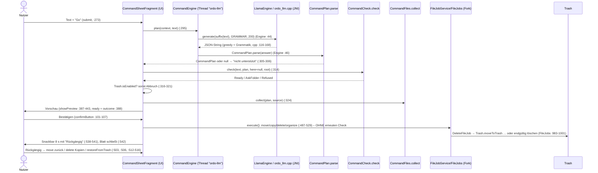
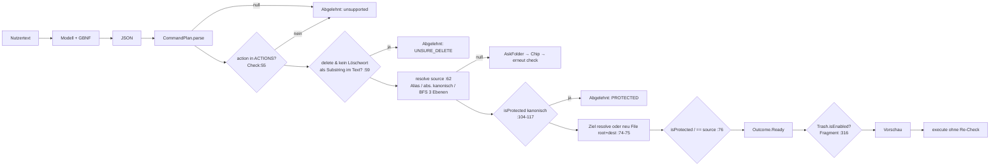
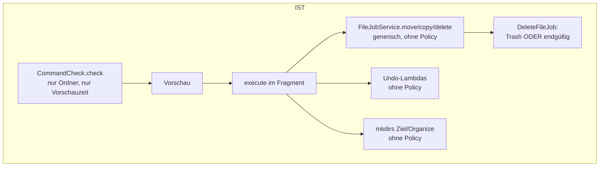
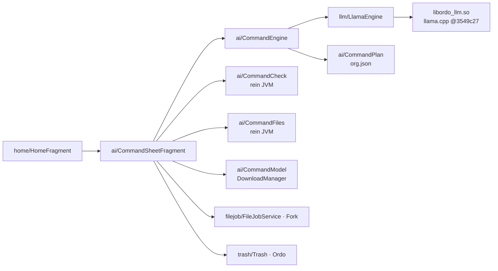

# Ordo – Architektur-Review der KI-Schicht (ARCH)

| Feld | Wert |
|---|---|
| Repo | https://github.com/BEKO2210/ordo (lokal read-only: `review/repo`) |
| Commit | `5cae53867b38bce494493c6b1170542afdaa6809` (main, 2026-11-14 20:38 MEZ, „Run the AI fully on the phone …“) |
| APK | `ordo-0.1.0-test4.apk`, SHA-256 `c8f8ccfed89c25aecc51d1e9d7a2d7f08ba5a11f9dddd93146645c64ca539d5d` – **geprüft: ja, stimmt mit BRIEF überein** |
| APK ↔ Commit | Modell-SHA, HF-Revision und Prompt-Strings aus `CommandModel`/`CommandCheck` sind in `classes14.dex` enthalten; `libordo_llm.so` für arm64-v8a und x86_64 vorhanden. Die APK ist **debuggable** (Debug-Build, nicht minifiziert). Ein Byte-Vergleich mit einem eigenen Build wurde nicht gemacht. |
| Datum | 2026-11-14, ca. 20:42–21:00 MEZ |
| Rolle | ARCH REVIEWER (Review-Team, Auftraggeber BEL 1) |
| Methode | Statische Analyse aller KI-Dateien und der Ausführungspfade in den Fork-Code (FileJobService, FileJobs, Trash). JVM-Probe: `CommandCheck`/`CommandPlan`/`CommandFiles`/`CommandPlanner` unverändert nach `<tmp>` kopiert (SHA-256 identisch zum Repo), mit kotlinc 2.1.0 + JDK 21 + org.json kompiliert; vorhandener `CommandCheckTest` (11 Tests) und eigene Sonden ausgeführt. `aapt2`/`strings` auf der APK. `gh` nur lesend (run list, release view), GitHub-API lesend für den llama.cpp-Pin. |
| Build/Test | **Gradle-Build nicht ausgeführt** (kein JDK/NDK-Build auf der Box wegen RAM, llama.cpp-Submodul lokal nicht ausgecheckt). **Unit-Tests: ja**, aber nur die reinen JVM-Klassen ohne Gradle (siehe Anhang). Instrumentierungstest `LlamaEngineTest`: nicht ausgeführt (Gerät/Emulator nötig). |

---

## Kurzfazit

Die KI-Schicht ist klein und gut lesbar. Ein Modell, das per GBNF-Grammatik nur ein festes JSON-Schema ausgeben kann, wird von einer **deterministischen** Prüfung (`CommandCheck`) gefolgt. Sie sitzt **hinter** dem Modell und arbeitet auf kanonischen Pfaden. Pfadtricks wie `..`, Groß-/Kleinschreibung, Symlinks und absolute Pfade halten in meinen Sonden. Dateinamen gelangen nie ins Modell, eine Prompt-Injection über Dateinamen ist also strukturell ausgeschlossen.

Die Schwächen liegen in drei Bereichen:

- **Durchsetzung an der Ausführungsstelle fehlt.** Die Papierkorb-Regel wird nur zur Vorschauzeit im UI geprüft. Der aufgerufene generische `DeleteFileJob` des Forks löscht still **endgültig**, wenn der Papierkorb zur Laufzeit aus ist oder ein Pfad nicht in den Papierkorb kann (ARCH-01). Es gibt keinen strukturellen Choke-Point und keine erneute Prüfung vor der Ausführung (ARCH-02). Bei Namenskonflikten kann der Fork-Dialog Zieldateien am Papierkorb vorbei überschreiben (ARCH-06).
- **Die Sperren „Löschwort“ und „DCIM/Camera“ sind Substring-Heuristiken über den ganzen Satz.** „Bitte nichts löschen …“ entsperrt Löschen. Jedes „Kamera“ irgendwo im Satz entsperrt DCIM/Camera, auch als Ziel (ARCH-03, ARCH-04).
- **Undo, Tests/CI, Prozessisolation und Modell-Lebenszyklus sind auf Prototyp-Niveau.** Undo ist nur 8 s lang als Snackbar verfügbar, ohne Journal (ARCH-05). Die native Inferenz läuft im App-Prozess (ARCH-07). Ein Absturz durch Emoji über JNI ist möglich (ARCH-08, Verdacht). Die KI-Commits liefen nie durch CI, und die CI führt keine Unit-Tests aus (ARCH-09).

**Findings: 20, davon Kritisch 0, Hoch 1, Mittel 8, Niedrig 7, Info 4.**

---

## Frage 1 – Fluss: Befehl → Modell → Plan → Prüfung → Vorschau → Bestätigung → Ausführung → Rückgängig



| Schritt | Ort (Datei:Zeile) | Bemerkung |
|---|---|---|
| Befehl | `ai/CommandSheetFragment.kt:273-311` (`submit`) | Einziger Einstieg: Button in `home/HomeFragment.kt:113-114`. Keine Intents, kein Teilen, keine Sprache. |
| Prompt-Aufbau | `ai/CommandPlanner.kt:11-15` | Fester System-Prompt plus Nutzertext; `<\|` wird zu `< \|` (`:15`). |
| Modell-Ausgabe | `ai/CommandEngine.kt:43-47` → `llm/LlamaEngine.kt:18-19` → `llm/src/main/cpp/ordo_llm.cpp:116-168` | Grammatik `CommandPlanner.kt:18-28`, greedy (`cpp:144`), max. 200 Token. |
| Plan | `ai/CommandPlan.kt:41-59` | Toleranter Parser (`optString`/Defaults). Kaputtes JSON führt zu `null` (P4a). |
| Prüfung | `ai/CommandCheck.kt:54-80` | Einziger Aufruf: `CommandSheetFragment.kt:314`. |
| Papierkorb-Vorprüfung | `CommandSheetFragment.kt:316-321` | Nur für `delete`, nur zur Vorschauzeit. |
| Dateiauswahl | `ai/CommandFiles.kt:24-35` | Nur oberste Ebene, keine versteckten Dateien, `isFile`. |
| Vorschau | `CommandSheetFragment.kt:387-443`; Filter-Chips `:446-485` | Zeigt Aktion, Route, Anzahl, Größe und 5 Namen. Ein Chip erweitert den Plan ohne neuen Check (`:452-456`), Quelle und Ziel bleiben dabei gleich. |
| Bestätigung | `CommandSheetFragment.kt:101-107` | Einziger Aufrufer von `execute()`. |
| Ausführung | `CommandSheetFragment.kt:487-543` → `filejob/FileJobService.kt:131-171` → `filejob/FileJobs.kt` (`CopyFileJob :767`, `DeleteFileJob :977`, `MoveFileJob :1158`) | Kein erneuter Check. `mkdirs()` läuft synchron im UI-Thread (`:498`, `:522`). |
| Rückgängig | `CommandSheetFragment.kt:494-541` | Vorhanden, aber nur 8 s (`UNDO_MILLIS :623`), nicht persistent und mit Race laut Code-Kommentar `:536-537` (→ ARCH-05). |

**Fehlende Schritte:** ein persistentes Undo-Journal; eine erneute Prüfung bzw. Plan-Bindung zwischen Vorschau und Ausführung (→ ARCH-02); ein Job-Ergebnis-Callback (Erfolg, Teilerfolg, Konflikt) zurück an die KI-Schicht; ein Protokoll/Audit, was die KI ausgeführt hat.

---

## Frage 2 – Ist `CommandCheck` deterministisch und sitzt sie hinter dem Modell?

**Deterministisch: ja.** `CommandCheck` enthält weder Zufall noch Modellaufrufe. Das Ergebnis hängt nur von `text`, `plan` und dem Dateisystemzustand ab. Die Breitensuche in `resolve` sortiert nach Namen (`CommandCheck.kt:119-121`). Auch das Modell ist greedy (`cpp:144`), kann aber je nach Thread-Anzahl und Hardware numerisch leicht abweichen. Das ist für die Prüfung unerheblich.

**Hinter dem Modell: ja.** Die Modellausgabe wird zu reinen Daten (`CommandPlan`) und durchläuft `check()`, bevor `ready` gesetzt werden kann (`:314`, `:388`). Das Modell kann die Prüfung nicht überspringen. Prüfung und Ausführung nutzen dasselbe `File`-Objekt (`Outcome.Ready.source/destination`), nicht den Roh-String.

**Aber:** Die Prüfung ist eine UI-Vorstufe und nicht die Ausführungsgrenze (ARCH-01/02). Zwei Sperren beruhen auf Substrings im Nutzersatz (ARCH-03/04).



### Sperren aus dem Brief – wo erzwungen, und halten sie?

| Harte Regel | Erzwungen in | Hält? | Nachweis |
|---|---|---|---|
| Nichts ohne Bestätigung | `CommandSheetFragment.kt:101-107` (einziger `execute()`-Aufrufer) | Ja. Einschränkung: Ein Fork-Konfliktdialog kann zusätzlich zum Überschreiben führen (ARCH-06). | statisch |
| Löschen nur in den Papierkorb | `CommandSheetFragment.kt:316` (Vorschau) und Semantik von `DeleteFileJob` (`FileJobs.kt:983-1001`) | **Nein, nicht an der Ausführungsstelle**: Fallback auf endgültiges Löschen (ARCH-01). `CommandCheck` selbst kennt keinen Papierkorb (`rg -n Trash CommandCheck.kt` → 0 Treffer), entgegen `docs/KI-BEFEHLE.md:86`. | statisch |
| Löschen ohne Löschwort | `CommandCheck.kt:34-37, 58-61` | **Teilweise**: Substring über den ganzen Satz, keine Negation (ARCH-03). Unicode-Tricks (NFD, Vollbreite, Zero-Width) führen nur zu Ablehnung, also in die sichere Richtung. | Sonden P1a–P1f |
| Android/data | `CommandCheck.kt:115` (ganzes `Android/`, kleingeschrieben, kanonisch) + `Trash.kt:43-62` | Ja (P3a/P3b/P3i) | Sonden |
| Versteckte Ordner | `CommandCheck.kt:114` (jede Pfadkomponente), Dateien `CommandFiles.kt:29` | Ja (P3h, Test `.OrdoTrash`) | Sonden + vorhandener Test |
| DCIM/Camera | `CommandCheck.kt:64, 116` | **Bedingt**: Jedes Kamerawort im Satz entsperrt den Ordner, auch als Ziel. Andere Kamera-Unterordner sind nicht geschützt (ARCH-04). | P2a, P2d, P2e |
| `..` | `CommandCheck.kt:106` (`canonicalPath`) | Ja (P3c, P3f, P3g, P3l) | Sonden |
| Groß/Klein-Tricks | `CommandCheck.kt:112-113` (Komponenten `lowercase(ROOT)`), `Trash.kt:58-60` | Ja für ASCII. Türkisches `İ` → `i̇` ≠ `android` (P3m = false). Ob FUSE/Casefold „ANDROİD“ als „Android“ auflöst: **Gerätetest nötig** (G3). | Sonde + Gerätetest |
| Symlinks | `canonicalPath` in `isProtected` | Ja für Ordner (P3d/P3e). Dateiebene: `CommandFiles` folgt Symlinks bei `isFile` (G9). | Sonde |
| Prompt-Injection über Dateinamen | Dateinamen kommen nie in den Prompt (`CommandEngine.kt:44`, `CommandPlanner.kt:11-15`) | **Ja, widerlegt** (ARCH-17) | statisch |
| Prompt-Injection über den Befehl | Grammatik (`CommandPlanner.kt:18-28`), `<\|`-Neutralisierung (`:15`), Check hinter dem Modell | Struktur hält. Der Inhalt ist jedoch der eigene Text des Nutzers, und die Heuristiken in ARCH-03/04 werten genau diesen Text aus. `parse_special=true` bleibt bestehen (ARCH-19). | statisch |

**Gibt es Pfade, auf denen Modellausgabe oder Dateinamen ungeprüft ausgeführt werden?**
- *Prüfung auf Strings vor der Normalisierung:* nein. Geschützte Pfade werden nach `canonicalPath` geprüft.
- *Prüfung auf dem Plan, Ausführung auf anderer Datenstruktur:* teilweise. Geprüft werden die Ordner, ausgeführt wird die `files`-Liste aus `CommandFiles.collect`. Sie ist durch Konstruktion auf die oberste Ebene des geprüften Quellordners begrenzt, wird aber selbst nicht geprüft. Die Organize-Unterordner (`:520-522`) und Undo-Ziele (`:503`, `:506`) gehen ohne Check durch. Heute sind sie durch Konstruktion sicher (App-Konstanten bzw. zuvor geprüfte Ordner), siehe ARCH-02.
- *TOCTOU zwischen Vorschau und Ausführung:* ja. `files`, `Trash.isEnabled` und die Existenz der Ordner stammen vom Vorschauzeitpunkt (ARCH-01/02).
- *Fallback bei Parse-Fehlern:* kein gefährlicher Fallback. `null` führt zur Ablehnung (`:305-306`). Ein abgeschnittenes JSON führt ebenfalls zu `null` (P4a).
- *Regex-/Heuristik-Planer ohne Modell:* existiert nicht. Fällt das Modell aus, gibt es keinen Ersatzplaner, sondern eine Fehlermeldung (`:296-303`).

---

## Frage 3 – Gibt es einen zentralen Choke-Point?

**Nein, nicht strukturell.** `CommandCheck.check` ist die einzige Policy-Stelle und wird genau einmal aufgerufen (`CommandSheetFragment.kt:314`, `rg -n "CommandCheck.check"` → 1 Treffer). Im aktuellen Code führt jeder Weg zu `execute()` über einen geprüften `Outcome.Ready`: `ready` wird nur in `showPreview` gesetzt (`:388`), und `showPreview` wird nur aus `evaluate` oder aus Filter-Chips mit unveränderter Quelle und unverändertem Ziel aufgerufen. **Einen konkreten Umgehungspfad habe ich nicht gefunden.**

Die Durchsetzung beruht aber auf Konvention im UI-Fragment:
- `execute()` ruft die generischen Fork-APIs `FileJobService.move/copy/delete/restoreFromTrash` direkt auf (`:502-515`, `:524`). Diese wissen nichts von KI-Policy.
- Die Ausführung prüft nicht erneut und ist nicht an den gezeigten Plan gebunden (kein Hash, kein unveränderliches Objekt).
- Undo-Operationen und `mkdirs()` umgehen den Check.
- Jede künftige Einstiegsstelle (Intent, Shortcut, „hier“ = aktueller Ordner, Sprachbefehl), die `FileJobService` direkt nutzt, hätte keine Sperren.



---

## Frage 4 – Trennung app/llm, Fehlerbehandlung, Threading/Lebenszyklus

**Modulgrenze:** sauber. `settings.gradle` bindet `:app` und `:llm` ein. `app/build.gradle:107` hängt von `:llm` ab, `:llm` hat keine App-Abhängigkeit (`llm/build.gradle:41-44` nur Test-Libs). Die JNI-Fläche ist minimal: 5 Funktionen (`LlamaEngine.kt:55-68`, `ordo_llm.cpp:69-181`). Prompt, Grammatik, Schema und Policy liegen alle in `:app`, `:llm` ist ein generischer Grammatik-Generator. Das ist gut für Austauschbarkeit. Die KI-Policy ist allerdings an Android-UI und Fork-Klassen gekoppelt und liegt nicht in einem eigenen reinen Modul.



**Fehlerbehandlung:**

| Fall | Verhalten | Ort |
|---|---|---|
| Modell nicht geladen / Laden fehlgeschlagen | `IOException` → Meldung „Start fehlgeschlagen“ + Retry | `CommandEngine.kt:66-71`, Fragment `:296-303` |
| Gerät zu klein | Nur bei der Einrichtung geprüft (RAM ≥ 6 GB gesamt, Platz, 64 Bit) | `CommandModel.kt:33-39, 52-62`, Fragment `:148-169` |
| OOM | Nicht abfangbar. Natives `mmap`/Allokation im App-Prozess; LMK oder `abort` beenden die ganze App, laufende Dateijobs eingeschlossen (ARCH-07) | `cpp:75`, kein `android:process` im Manifest |
| Timeout | Kein Timeout, nur `maxTokens=200` und manueller Abbruch | `CommandEngine.kt:44` |
| Kaputtes/abgeschnittenes JSON | `null` → „nicht unterstützt“ (für den Nutzer irreführend) | `CommandPlan.kt:57-58`, Fragment `:305-306` |
| Eingabe länger als der Kontext | Kein `maxLength`; `llama_decode` schlägt fehl → „Start fehlgeschlagen“ (ARCH-14) | `cpp:50-63`, `command_sheet.xml:163-167` |
| Nativer Crash / ungültiges UTF-8 | Kein Schutz; mögliche CheckJNI-Abbrüche (ARCH-08) | `cpp:33, 167` |

**Threading/Lebenszyklus:** Alle nativen Aufrufe laufen auf einem eigenen Thread (`CommandEngine.kt:25-27`), richtig für llama.cpp. Nach 3 Minuten Leerlauf wird entladen (`:28, 59-63`); dieser Job läuft auf demselben Dispatcher und kann nicht parallel zu `generate` laufen. Schwächen (ARCH-13):
- Nur der Abbrechen-Button ruft `CommandEngine.cancel()` (`:95-99`). Ein neuer `submit` (`:279`) oder das Schließen des Blatts bricht die native Generierung nicht ab.
- Das Abbruch-Flag wird bei jedem `generate` zurückgesetzt (`cpp:121`), ein früher Abbruch geht verloren.
- `cancel()` vom Main-Thread gegen `close()` auf `ordo-llm`: `handle` ist nicht volatile (`LlamaEngine.kt:14, 21-32`), theoretisch ein Use-after-free.
- UI-Zustand (`text`, `ready`, `files`, `:64-67`) überlebt keine Konfigurationsänderung.

---

## Frage 5 – Testbarkeit und CI

| Bereich | Tests | Rein ohne Android testbar? |
|---|---|---|
| `CommandCheck` | `app/src/test/.../ai/CommandCheckTest.kt` (11 Tests) – **lokal 11/11 grün** (JUnitCore, kotlinc 2.1.0, ohne Gradle) | **Ja**, nur `java.io.File` |
| `CommandFiles` | in `CommandCheckTest` (`files_filterByKindAgeSize`) | Ja |
| `CommandPlan` (Einheiten) | in `CommandCheckTest.units` | Ja |
| `CommandPlan.parse` | **kein Test**. `org.json` ist nicht als `testImplementation` eingebunden (`app/build.gradle:111` nur junit). Mit dem android.jar-Stub würde `parse` in Unit-Tests vermutlich jede Eingabe wegen `catch (e: Exception)` still zu `null` machen (Verdacht). | Mit `org.json:json` als Testabhängigkeit ja (in meiner Probe funktionierte es) |
| `CommandPlanner` (Grammatik ↔ Parser ↔ bench.py) | kein Test. Prompt mit `bench.py` heute **identisch** (eigene Prüfung, 2870 Zeichen) | Ja |
| `CommandEngine`, `CommandModel` | keine | Nein (Singletons mit `Context`, DownloadManager, JNI) |
| `CommandSheetFragment.execute`/Undo | keine | Nein (Logik im Fragment) |
| `llm` | `llm/src/androidTest/.../LlamaEngineTest.kt` (Instrumentierung, wird ohne `test.gguf` übersprungen) | Nein |

**CI:** `.github/workflows/android.yml:3-5` läuft nur bei `pull_request`/`workflow_dispatch`, umgestellt in `ef16c459` (2026-11-14 13:27 MEZ). Der Schritt `:23` macht `assembleDebug lintVitalRelease`, **ohne `test`**. Die letzten „Android CI“-Läufe waren 2026-11-14 13:06 und 13:26 MEZ (`gh run list`). Die KI-Commits `25a0eb12` (20:03) und `5cae5386` (20:38) wurden direkt auf main gepusht und **nie von CI gebaut**. Das Release `v0.1.0-test4` entstand am selben Tag um 20:38 MEZ und ist ein Debug-Build (ARCH-09).

---

## Frage 6 – Abhängigkeit vom Fork-Code und llama.cpp-Einbindung

- **Fork-Kopplung (KI → Fork):** Es gibt 5 Berührungspunkte: `FileJobService` (move/copy/delete/restoreFromTrash), `Trash` (isEnabled, entries), `Settings.TRASH_RETENTION_DAYS`, `java8.nio.file.Paths` und `HomeFragment` als Einstieg. Die KI nutzt `java.io.File` und nicht die Provider-Abstraktion des Forks. Das passt zur Beschränkung auf den internen Speicher, macht die Prüfung aber zu einer Parallelwelt neben den Fork-Pfaden.
- **Upstream-Merge-Fähigkeit:** Letzter Upstream-Commit im Verlauf ist `93c33396` (Hai Zhang, 2026-10-15). Seitdem gibt es 42 eigene Commits und 328 geänderte Dateien (+13963/−691). `FileJobs.kt` +502 Zeilen (Trash, Vault, Backup) und `FileJobService.kt` +35 Zeilen sind die Hauptkonfliktquellen bei Upstream-Merges. Der Paketname `me.zhanghai.android.files` blieb erhalten, das hilft beim Mergen. Die KI liegt sauber im eigenen Paket `ai/` bzw. Modul `:llm`.
- **llama.cpp:** Git-Submodul (`.gitmodules`, URL `https://github.com/ggml-org/llama.cpp`), gepinnt per Gitlink auf `3549c274dc22001d9118713fa56a10085b85de3b`. Laut GitHub-API ist das ein **ungetaggter master-Commit vom 2026-11-14 15:19 MEZ** („convert : register Granite4Vision…“), Stand der Prüfung 3 Commits hinter master. Der Commit ist upstream vorhanden, also reproduzierbar auscheckbar. Allerdings lädt `GGML_CPU_KLEIDIAI ON` (`llm/src/main/cpp/CMakeLists.txt:17-20`) zur Build-Zeit KleidiAI v1.32.0 per `FetchContent` aus dem Netz, nur per MD5 gesichert (llama.cpp@3549c27 `ggml/src/ggml-cpu/CMakeLists.txt:653-667`). Der Build ist damit nicht offline/hermetisch, für F-Droid relevant (ARCH-15). `ordo_llm.cpp` nutzt neuere APIs (`llama_memory_clear`, `llama_state_seq_*`, `llama_vocab`), bei Version-Bumps ist API-Churn zu erwarten.

---

## Frage 7 – Update-Fähigkeit des Modells

| Aspekt | Ist | Ort |
|---|---|---|
| Download-URL | HF `unsloth/Qwen3.5-4B-GGUF`, **feste Revision** `e87f1764…`, HTTPS über DownloadManager | `CommandModel.kt:23-24, 90-101` |
| Integrität | Größe + **SHA-256 fest im APK**; falsche Datei wird gelöscht. Eine Signatur ist nicht nötig, solange der Hash im signierten APK steckt. | `CommandModel.kt:25-26, 104-113` |
| Prüfung beim Laden | **keine**: `Ready` = Flag `verified` + Dateigröße (ARCH-11) | `CommandModel.kt:64-69` |
| Versionierung | Fester Dateiname, das Boolean-Flag `verified` ist nicht an Hash oder Version gebunden, keine Migration; ein umbenanntes Modell hinterlässt eine verwaiste 2,7-GB-Datei | `CommandModel.kt:27-30, 115-123` |
| Prompt-/Grammatik-Kopplung | Qwen-Chat-Template (`<\|im_start\|>`, leeres `<think>`) hart kodiert; Prefix-Snapshot abhängig vom Modell (Qwen3.5 mit rekurrenten Schichten, `docs/KI-BEFEHLE.md:80-81`); Grammatik modellneutral | `CommandPlanner.kt:10-15` |
| Austauschbarkeit | Nur per App-Update und Codeänderung; kein Modell-Manifest | – |
| Netz | `setAllowedOverRoaming(false)`, aber kein `setAllowedOverMetered(false)`: 2,7 GB können über Mobilfunk laufen | `CommandModel.kt:95-99` |

---

## Findings-Tabelle

| ID | Schwere | Titel | Status |
|---|---|---|---|
| ARCH-01 | Hoch | Papierkorb-Regel nicht an der Ausführungsstelle erzwungen; `DeleteFileJob` fällt still auf endgültiges Löschen zurück | bestätigt (Codepfad); Auslösung: Gerätetest |
| ARCH-02 | Mittel | Kein struktureller Choke-Point, keine erneute Prüfung bei der Ausführung, kein gebundener Plan (TOCTOU) | bestätigt (statisch); aktuell kein Umgehungspfad gefunden |
| ARCH-03 | Mittel | Löschwort-Sperre ist eine Substring-Heuristik über den ganzen Satz (Negation, Ordnernamen) | bestätigt (Sonde) |
| ARCH-04 | Mittel | DCIM/Camera-Sperre bedingt und lückenhaft (Kamerawort irgendwo entsperrt, auch als Ziel; andere DCIM-Ordner ungeschützt) | bestätigt (Sonde) |
| ARCH-05 | Mittel | Rückgängig nur flüchtig (8 s), mit Race, unvollständig, ohne Journal | bestätigt (statisch) |
| ARCH-06 | Mittel | Namenskonflikt „Ersetzen“ überschreibt Zieldateien am Papierkorb vorbei | bestätigt (statisch); Gerätetest |
| ARCH-07 | Mittel | Native Inferenz im App-Prozess, keine Crash-/OOM-Isolation | Verdacht; Gerätetest |
| ARCH-08 | Mittel | JNI-Strings als Modified UTF-8: Emoji/4-Byte-Zeichen → möglicher CheckJNI-Abbruch (debuggable APK) | Verdacht; Gerätetest |
| ARCH-09 | Mittel | CI ohne Unit-Tests und nicht auf main; KI-Commits nie in CI; Test-APK ist ein Debug-Build | bestätigt |
| ARCH-10 | Niedrig | Testlücken: parse, Grammatik↔Parser, Ausführung/Undo, Engine/Model nicht testbar | bestätigt |
| ARCH-11 | Niedrig | Modell-Integrität nur beim Download; Laden vertraut Flag + Größe; keine Versionierung/Migration; Mobilfunk-Download | bestätigt (statisch); Ausnutzbarkeit Verdacht |
| ARCH-12 | Niedrig | Prompt/Template fest an Qwen3.5 gekoppelt, Prompt-Duplikat zu bench.py ohne Test | bestätigt |
| ARCH-13 | Niedrig | Abbruch/Lebenszyklus: native Generierung läuft weiter, Abbruch kann verloren gehen, cancel/close-Race, Zustand geht bei Rotation verloren | bestätigt (statisch); Race Verdacht |
| ARCH-14 | Niedrig | Eingabelänge unbegrenzt bei n_ctx 2048; irreführende Fehlermeldungen | bestätigt (statisch) |
| ARCH-15 | Niedrig | llama.cpp auf ungetaggten master-Commit gepinnt; KleidiAI zur Build-Zeit aus dem Netz (MD5) | bestätigt |
| ARCH-16 | Niedrig | Zielauflösung: absolutes Ziel außerhalb von root wird verschachtelter Neuordner; mehrdeutige Namen ohne Rückfrage | bestätigt (Sonde) |
| ARCH-17 | Info | Prompt-Injection über Dateinamen | widerlegt |
| ARCH-18 | Info | `..`-/Case-/Symlink-/Absolutpfad-Tricks gegen `isProtected` | widerlegt (JVM); Unicode-Casefold auf FUSE: Gerätetest |
| ARCH-19 | Info | `parse_special=true` beim Tokenisieren des Nutzertexts | Verdacht (geringe Auswirkung) |
| ARCH-20 | Info | Modulgrenze sauber; KI-Policy aber im App-/UI-Code; Fork-Divergenz erschwert Upstream-Merges | bestätigt |

---

## Findings im Detail

### ARCH-01 – Papierkorb-Regel nicht an der Ausführungsstelle erzwungen; stiller Fallback auf endgültiges Löschen
- **Schweregrad: Hoch.** Verletzt die harte Regel „Löschen nur in den Papierkorb“ an der einzigen Stelle, an der sie unumkehrbar wird. Die Folge wäre endgültiger Datenverlust. Die Eintrittswahrscheinlichkeit im heutigen Ablauf ist gering, daher nicht Kritisch.
- **Dateien:** `ai/CommandSheetFragment.kt:316-321` (Prüfung `Trash.isEnabled` nur zur Vorschauzeit), `:509-510` (`FileJobService.delete(chosen…)` mit Default `permanently=false`); `filejob/FileJobService.kt:139-141`; `filejob/FileJobs.kt:983-987` (Partition: nur `Trash.canTrash` in den Papierkorb, **alles andere sowie alles bei `!Trash.isEnabled` → `deletePaths`**), `:996-1000` (`deleteRecursively`); `trash/Trash.kt:49-50, 53-62, 69`.
- **Codepfad:** Bestätigen → `execute()` → `FileJobService.delete` → `DeleteFileJob.run()` liest `Trash.isEnabled` **zur Laufzeit** erneut. Bei `false` oder nicht trashbarem Pfad folgt `deleteRecursively`, also endgültiges Löschen. Die KI-Schicht kann den Unterschied nicht sehen. `CommandCheck` enthält keine Papierkorb-Logik (`rg -n "Trash" app/src/main/java/me/zhanghai/android/files/ai/CommandCheck.kt` → 0 Treffer), obwohl `docs/KI-BEFEHLE.md:86` das behauptet.
- **Erwartet:** Ein KI-Löschbefehl verschiebt entweder in den Papierkorb oder bricht mit Fehler ab. Endgültiges Löschen ist auf diesem Pfad unmöglich.
- **Ist:** Die Garantie hängt an einer UI-Vorprüfung und daran, dass alle Pfade unter `/storage/emulated/N/…` trashbar sind. Heute trifft das für die von `CommandCheck` erlaubten Pfade zu (Android/… ist ohnehin gesperrt). Ändert sich aber `Trash.isEnabled` zwischen Vorschau und Job, oder liefert `Environment.getExternalStorageDirectory()` einen Pfad, der nicht auf `ROOT_REGEX` (`Trash.kt:45-47`) passt, wird endgültig gelöscht.
- **Nachweis:** statisch (`sed -n '977,1001p' app/src/main/java/me/zhanghai/android/files/filejob/FileJobs.kt`). Auslösbarkeit: **Gerätetest nötig** (G1).
- **Status:** bestätigt (Codepfad); Auslösung offen.
- **Empfehlung (P0):** Eigene Job-Variante `TrashOnlyJob`/`delete(paths, mode = TRASH_ONLY)`, die bei `!isEnabled || !canTrash(path)` **fehlschlägt statt löscht**. Die KI-Schicht ruft ausschließlich diese auf. Zusätzlich vor dem Start erneut prüfen. Unit-Test für die Partitionslogik.

### ARCH-02 – Kein struktureller Choke-Point, kein Re-Check bei der Ausführung, kein gebundener Plan
- **Schweregrad: Mittel.** Heute ist kein Umgehungspfad nachweisbar. Die Sicherheit hängt aber an Konventionen in einem 626-Zeilen-Fragment. Für „die sicherste KI-Dateiverwaltung“ ist das vor 1.0 zu beheben.
- **Dateien:** `CommandSheetFragment.kt:314` (einziger Check-Aufruf), `:388` (`ready = outcome`), `:452-456` (Chip ändert den Plan ohne Check), `:487-543` (`execute` ohne Check), `:498` und `:520-522` (`mkdirs` ohne Check), `:503/:506/:512-516` (Undo ohne Check), `:492` (`chosen = files` vom Vorschauzeitpunkt).
- **Codepfad/Reproduktion:** `rg -n "CommandCheck.check|ready = " app/src/main/java/me/zhanghai/android/files/ai/CommandSheetFragment.kt` → `314`, `378`, `388`, `558`. `sed -n '487,543p' …` zeigt: kein Aufruf von `CommandCheck`/`isProtected`, direkte `FileJobService`-Aufrufe.
- **Erwartet:** Eine Policy-Engine als einzige Schnittstelle zur Ausführung. Sie nimmt nur einen unveränderlichen, geprüften Plan (mit Hash) an, prüft ihn bei der Ausführung erneut (Existenz, kanonischer Pfad pro Datei, Papierkorb) und lehnt sonst ab.
- **Ist:** Die Prüfung umfasst nur Ordner und nur die Vorschauzeit. Die Dateiliste, Ziel-`mkdirs` und Undo laufen ungeprüft gegen generische Fork-APIs. Eine Datei, die zwischen Vorschau und Bestätigen ersetzt wird (z.B. durch einen Ordner gleichen Namens), wird trotzdem verarbeitet.
- **Nachweis:** statisch. **Status:** bestätigt (Architektur). Bypass: widerlegt für den aktuellen Code.
- **Empfehlung (P0/P1):** Siehe Ziel-Architektur unten: `PolicyEngine.authorize(CheckedPlan)` → `AiExecutor` als einziger Aufrufer von `FileJobService`, mit Re-Check pro Datei kurz vor dem Job.

### ARCH-03 – Löschwort-Sperre ist eine Substring-Heuristik über den ganzen Satz
- **Schweregrad: Mittel.** Die Sperre „Löschen ohne Löschwort“ lässt sich durch Negation oder Ordnernamen aushebeln. Abgefedert wird das durch die rote Vorschau und den Papierkorb (sofern ARCH-01 nicht greift).
- **Dateien:** `ai/CommandCheck.kt:34-37` (Wortliste), `:58-61` (`DELETE_WORDS.none { it in lower }` auf dem gesamten Text).
- **Reproduktion:** JVM-Sonde (Anhang):
  - P1a: `check("Bitte nichts löschen, nur die PDFs aus Download nach Music verschieben", CommandPlan("delete","Download"))` → `Ready`.
  - P1b: `check("Kopiere alle PDFs aus Download nach Entfernte Projekte", CommandPlan("delete","Download"))` → `Ready`.
- **Erwartet:** Die Sperre lässt `delete` nur zu, wenn der Nutzer das Löschen als Aktion meint.
- **Ist:** Ein beliebiges Vorkommen eines Wortstamms (auch in Ordnernamen oder verneint) reicht, wenn das Modell `delete` ausgibt. Unicode-Varianten (NFD, Vollbreite, Zero-Width; P1d–P1f) werden abgelehnt, also sichere Richtung.
- **Nachweis:** Build-Unit-Test (JVM-Sonde, ohne Gradle). **Status:** bestätigt.
- **Empfehlung (P0):** Ein Teil davon ist Produktentscheidung. Technisch: (a) Wortgrenzen und Negationserkennung (`nicht|nichts|kein|don't|not`) in einem Fenster vor dem Wort; (b) Löschwort außerhalb der vom Modell extrahierten `source`/`destination`/`name_contains`-Spannen verlangen; (c) für `delete` eine zweite, andersartige Bestätigung (z.B. gedrückt halten, oder das Aktionswort im Button). Testfälle P1a/P1b als Regressionstests aufnehmen.

### ARCH-04 – DCIM/Camera-Sperre bedingt und lückenhaft
- **Schweregrad: Mittel.** Der Brief nennt DCIM/Camera als harte Sperre. Im Code ist sie per Wort im Satz abschaltbar, und zwar für Quelle **und Ziel**.
- **Dateien:** `ai/CommandCheck.kt:39` (`CAMERA_WORDS`), `:51` (Alias `kamera`/`camera` → `DCIM/Camera`), `:64` (`cameraNamed` = Substring im ganzen Text), `:116` (Sperre nur, wenn `!cameraNamed` und genau `dcim/camera`). Vorhandener Test `CommandCheckTest.kt:96-104` bestätigt die Absicht „nur wenn genannt“.
- **Reproduktion (Sonde):**
  - P2a: `"Verschiebe alte Videos aus Download nach Kamera-Backup und lösche Reste"` + `delete Kamera` → `Ready(source=…/DCIM/Camera)`.
  - P2e: `move Download → Kamera` → `Ready(destination=…/DCIM/Camera)`.
  - P2d: `"lösche alles in 100ANDRO"` (ohne Kamerawort) → `Ready(…/DCIM/100ANDRO)`.
- **Erwartet (laut Brief):** DCIM/Camera hält. Andere Kamera-Ordner unter DCIM sind entsprechend geschützt.
- **Ist:** Das Wort entsperrt den Ordner. Nur der Pfad `DCIM/Camera` ist geschützt; Hersteller- und App-Ordner (`DCIM/100ANDRO`, `DCIM/OpenCamera`, …) nicht.
- **Nachweis:** Build-Unit-Test (Sonde). **Status:** bestätigt.
- **Empfehlung (P0, Entscheidung Belkis):** Entweder DCIM/** für `delete`/`move`/`organize` als Quelle und für alle Aktionen als Ziel hart sperren (nur `copy` heraus erlauben), oder die Entsperrung über einen expliziten UI-Schalter in der Vorschau statt über Text. Die Sperre auf `parts.firstOrNull() == "dcim"` ausweiten.

### ARCH-05 – Rückgängig nur flüchtig, mit Race, unvollständig, ohne Journal
- **Schweregrad: Mittel.** Undo ist laut Brief Teil des Sicherheitskonzepts, funktioniert aber nur im Idealfall.
- **Dateien:** `CommandSheetFragment.kt:499-500` (`placed` vor dem Job berechnet), `:503`, `:506`, `:511-516` (Restore filtert `Trash.entries()` nur nach `originalPath`), `:536-537` (Kommentar: Undo „can race the running job“), `:538-541`, `:623` (`UNDO_MILLIS = 8_000`); `trash/Trash.kt:129-145, 147-164`; `filejob/FileJobs.kt:2426-2443`.
- **Codepfad:**
  - (a) Nach 8 s, nach Prozessende oder bei verdeckter Snackbar ist das Undo weg.
  - (b) Undo direkt nach Bestätigen kann laufen, bevor der Job fertig ist.
  - (c) Benennt der Konfliktdialog um (RENAME) oder ersetzt er (REPLACE), fehlen diese Dateien in `placed` bzw. ihre Originale sind weg.
  - (d) Das Delete-Undo stellt **alle** Papierkorb-Einträge mit gleichem Originalpfad wieder her, auch ältere, nicht von diesem Befehl gelöschte (Ziel dann „name (1).ext“).
  - (e) `Trash.entries()` liest im Main-Thread.
  - (f) Organize-Unterordner bleiben nach Undo stehen.
- **Erwartet:** Ein persistentes, an Job-IDs gebundenes Undo-Journal (Quelle, Ziel, Trash-ID pro Datei), abrufbar auch später.
- **Ist:** Ein flüchtiges Lambda in einer Snackbar.
- **Nachweis:** statisch. Laufzeitverhalten: Gerätetest G5/G11. **Status:** bestätigt (statisch).
- **Empfehlung (P1):** Journal-Datei bzw. Room-Tabelle pro KI-Befehl. `DeleteFileJob`/`MoveFileJob` geben die tatsächlich erzeugten Ziele bzw. Trash-IDs zurück. Undo arbeitet nur mit diesen IDs. Ein „Letzte KI-Aktionen“-Eintrag im Papierkorb/Verlauf.

### ARCH-06 – Konflikt „Ersetzen“ überschreibt am Papierkorb vorbei
- **Schweregrad: Mittel.** Das endgültige Überschreiben ist faktisch ein Löschen ohne Papierkorb, ausgelöst durch einen Fork-Dialog, der nicht Teil der KI-Vorschau ist.
- **Dateien:** `filejob/FileJobs.kt:1374-1376` (`REPLACE_EXISTING`), `:1405-1408` („für alle ersetzen“), `:1417-1433` (`MERGE_OR_REPLACE` → `replaceExisting = true`); KI-Aufrufe `CommandSheetFragment.kt:502, 505, 524`.
- **Codepfad:** KI-Move/Copy/Organize → Zieldatei existiert → `showConflictDialog` → Nutzer wählt „Ersetzen“ → `moveTo/copyTo(REPLACE_EXISTING)` → die alte Zieldatei ist endgültig weg. Das KI-Undo fasst sie bewusst nicht an (`:499-500`).
- **Erwartet:** Für KI-Jobs gilt eine feste Konfliktstrategie „beide behalten“ oder „überspringen“, oder die alte Zieldatei kommt vorher in den Papierkorb.
- **Ist:** Die Fork-Standardlogik inklusive „für alle ersetzen“ gilt.
- **Nachweis:** statisch. Gerätetest G4. **Status:** bestätigt (statisch).
- **Empfehlung (P0):** Parameter `conflictPolicy = KEEP_BOTH` für KI-Jobs, oder Vorschau zeigt Konflikte vorab und erzwingt Umbenennen.

### ARCH-07 – Native Inferenz im App-Prozess, keine Crash-/OOM-Isolation
- **Schweregrad: Mittel.** Ein 2,7-GB-Modell mit ~3,3 GB Spitzenbedarf (`CommandModel.kt:32`) läuft im selben Prozess wie `FileJobService`. LMK-Kill oder nativer `abort` beenden laufende Kopier-/Verschiebejobs mitten im Vorgang.
- **Dateien:** `CommandEngine.kt:24-27, 66`; `ordo_llm.cpp:75` (`llama_model_load_from_file`, default mmap); `AndroidManifest.xml` ohne `android:process` (`rg -n "android:process" app/src/main/AndroidManifest.xml` → 0 Treffer). Die RAM-Prüfung erfolgt nur einmal bei der Einrichtung (Fragment `:148-169`), nicht vor jedem Laden. Ob andere Apps gerade Speicher belegen, wird nicht beachtet.
- **Erwartet:** Inferenz in eigenem Prozess (`:llm`-Service, Binder/AIDL); ein Absturz dort führt nur zu „KI nicht verfügbar“.
- **Ist:** Ein gemeinsamer Prozess.
- **Nachweis:** statisch. Auswirkung: Gerätetest G6. **Status:** Verdacht (Auswirkung), Architektur bestätigt.
- **Empfehlung (P1):** `LlmService` mit `android:process=":llm"`, Aufruf per Messenger/AIDL; vor `load` `ActivityManager.getMemoryInfo().availMem` prüfen.

### ARCH-08 – JNI-Strings als Modified UTF-8: möglicher Absturz bei Emoji/4-Byte-Zeichen
- **Schweregrad: Mittel.** Ein Absturz der ganzen App durch eine normale Eingabe (Emoji im Ordnernamen) ist plausibel, vor allem in der debuggable Test-APK, in der ART CheckJNI standardmäßig aktiv ist.
- **Dateien:** `ordo_llm.cpp:33` (`GetStringUTFChars` liefert Modified UTF-8/CESU-artig an den Tokenizer), `:167` (`NewStringUTF(output)` mit Standard-UTF-8 aus llama.cpp). Grammatik `CommandPlanner.kt:27` erlaubt beliebige Nicht-ASCII-Zeichen in Strings. APK `application-debuggable` (aapt2).
- **Codepfad:** Nutzer tippt „Verschiebe alle PDFs aus Download nach 📁Steuern“ → das Modell kopiert das Emoji in `destination` → `output` enthält eine 4-Byte-UTF-8-Sequenz → `NewStringUTF` erwartet Modified UTF-8 → CheckJNI meldet „input is not valid Modified UTF-8“ und bricht ab (Verdacht). Außerdem: Bricht die Generierung bei `maxTokens` mitten in einem Mehrbyte-Zeichen ab, ist die Ausgabe ungültiges UTF-8.
- **Erwartet:** Byte-genaue Übergabe (`jbyteArray` + Dekodierung in Kotlin mit `Charsets.UTF_8`).
- **Nachweis:** statisch. **Gerätetest nötig** (G2). **Status:** Verdacht.
- **Empfehlung (P0):** `nativeGenerate` gibt `ByteArray` zurück und nimmt `ByteArray` (UTF-8) entgegen. Zusätzlich die Eingabe vor dem Senden auf gültiges UTF-16 prüfen.

### ARCH-09 – CI ohne Unit-Tests und nicht auf main; KI-Commits nie in CI; Test-APK ist ein Debug-Build
- **Schweregrad: Mittel.** Die einzige automatisierte Absicherung der Sicherheitsregeln (`CommandCheckTest`) läuft nirgends automatisch.
- **Dateien:** `.github/workflows/android.yml:3-5` (nur `pull_request`, `workflow_dispatch`), `:23` (`assembleDebug lintVitalRelease`, kein `test`); Commit `ef16c459` (CI „nur bei Pull-Requests“).
- **Reproduktion:**
  - `gh run list -R BEKO2210/ordo -w "Android CI" -L 5`: letzte Läufe 2026-11-14 13:06/13:26 MEZ. `git log` zeigt `25a0eb12` (20:03) und `5cae5386` (20:38) danach direkt auf main.
  - `aapt2 dump badging ordo-0.1.0-test4.apk` → `application-debuggable`; 23 `classes*.dex` (nicht minifiziert, obwohl `app/build.gradle:62` für Release `minifyEnabled true` setzt).
- **Erwartet:** CI auf push+PR mit `testDebugUnitTest` und Lint. Testreleases als signierte Release-Builds oder zumindest klar als Debug gekennzeichnet.
- **Ist:** wie oben beschrieben.
- **Nachweis:** statisch + gh (lesend) + aapt2. **Status:** bestätigt.
- **Empfehlung (P0):** `on: [push, pull_request]`, Schritt `./gradlew testDebugUnitTest :app:lintVitalRelease`. Die native Kompilierung per Cache bzw. eigenem Job beschleunigen. Testrelease aus `assembleRelease` (R8) bauen, sonst sind die Ergebnisse von Gerätetests (Timing, JNI-Checks) nicht repräsentativ.

### ARCH-10 – Testlücken in der KI-Schicht
- **Schweregrad: Niedrig.** Die reinen Kernklassen sind testbar und teilweise getestet. Die kritischen Übergänge (Parser, Ausführung, Undo) sind es nicht.
- **Dateien:** `app/build.gradle:111` (nur `junit`, kein `org.json:json`); `CommandPlan.kt:8-9, 41-59`; Ausführungslogik im Fragment `:487-543`; `CommandEngine`/`CommandModel` als `object` mit `Context`.
- **Reproduktion:** `rg -n "parse\(" app/src/test` → kein Test für `CommandPlan.parse`.
- **Erwartet:** Unit-Tests für Parser (gültig, abgeschnitten, fehlende Felder), Grammatik↔Parser (jede grammatikgültige Ausgabe ist parsebar), Executor/Undo mit Fake-`FileOps`, Papierkorb-Partition.
- **Status:** bestätigt.
- **Empfehlung (P1):** `testImplementation 'org.json:json:…'`, die Ausführungslogik aus dem Fragment in eine reine Klasse `AiExecutor(fileOps: FileOps)` ziehen, Property-Tests für `CommandCheck` (Zufallspfade mit `..`, Case, Unicode).

### ARCH-11 – Modell-Integrität nur beim Download; Versionierung schwach
- **Schweregrad: Niedrig.** Der Hash im APK ist gut. Beim Laden prüft die App aber nur Flag und Größe. Ein manipuliertes GGUF würde vom nativen Parser im Prozess mit `MANAGE_EXTERNAL_STORAGE` geladen. Auf API 23–28 ist `getExternalFilesDir` für Apps mit Speicherrecht schreibbar (minSdk 23, `app/build.gradle:20`).
- **Dateien:** `CommandModel.kt:50` (Ablage in `getExternalFilesDir("models")`), `:64-69` (`Ready` = `verified` + `length == SIZE`), `:27-30` (fester Name, Boolean-Flag), `:95-99` (kein `setAllowedOverMetered(false)`), `:115-123` (`remove` löscht nur den aktuellen Namen).
- **Erwartet:** Ein Modell-Manifest (`id`, `version`, `sha256`, `size`, `template`) und das Flag `verifiedSha = <sha>`. Erneute Prüfung beim Laden nach App-Update oder geänderter mtime. Ablage im internen `filesDir`. Altdateien aufräumen.
- **Nachweis:** statisch. Manipulation: Gerätetest G10. **Status:** bestätigt (statisch), Ausnutzbarkeit Verdacht.
- **Empfehlung (P1):** wie unter „Erwartet“. Ein Download nur über WLAN als Standard.

### ARCH-12 – Prompt/Template fest an Qwen3.5 gekoppelt
- **Schweregrad: Niedrig.** Das schränkt den Modellwechsel ein, ist aber kein Sicherheitsproblem, solange Grammatik und Check greifen.
- **Dateien:** `CommandPlanner.kt:8` („keep both in sync“ mit `utils/command-bench/bench.py`), `:10-15` (ChatML + leeres `<think>`); `docs/KI-BEFEHLE.md:80-81` (Snapshot-Strategie wegen rekurrenter Schichten).
- **Reproduktion:** Eigener Vergleich `CommandPlanner.PREFIX` gegen `bench.py SYSTEM` → identisch (2870 Zeichen, Anhang). Ein Test dafür existiert nicht.
- **Status:** bestätigt.
- **Empfehlung (P2):** Chat-Template aus den GGUF-Metadaten (`llama_chat_apply_template`) oder aus dem Modell-Manifest. Prompt in eine gemeinsame Ressource (z.B. `prompt.txt`), die App und bench.py lesen, plus Test.

### ARCH-13 – Abbruch und Lebenszyklus
- **Schweregrad: Niedrig.** Das betrifft Ressourcen und UX; ein Datenrisiko habe ich nicht gefunden.
- **Dateien:** `CommandSheetFragment.kt:95-99` (nur der Button ruft `CommandEngine.cancel()`), `:279` (`submit` bricht nur die Coroutine ab), `:135-138` (`onDestroyView` ohne `cancel`), `:64-67` (Zustand nicht gesichert); `ordo_llm.cpp:121` (`cancelled = false` bei jedem Start); `LlamaEngine.kt:14` (`handle` nicht volatile), `:21-32`; `CommandEngine.kt:50-56, 76-79`.
- **Codepfad:**
  - Blatt schließen während der Generierung: Der Thread `ordo-llm` rechnet bis zu 200 Token weiter, und ein neuer Befehl wartet darauf.
  - `cancel()` vor dem Start von `generate` (Modell lädt noch): Der Abbruch geht verloren.
  - `cancel()` gleichzeitig mit dem Idle-Unload: theoretisch Use-after-free.
- **Nachweis:** statisch. Race: Verdacht. Rotation: Gerätetest G8. **Status:** bestätigt (statisch), Race Verdacht.
- **Empfehlung (P1):** `CommandEngine.cancel()` in `onDestroyView` und vor jedem neuen `submit` aufrufen. Ein Generations-Token bzw. eine Generation-ID statt eines globalen Flags. `handle` als `AtomicLong`, `close` und `cancel` synchronisiert. Zustand in ein ViewModel verlagern.

### ARCH-14 – Eingabelänge unbegrenzt bei n_ctx 2048; irreführende Fehlermeldungen
- **Schweregrad: Niedrig.**
- **Dateien:** `CommandEngine.kt:44` (`maxTokens 200`), `:66` (`contextSize 2048`); `docs/KI-BEFEHLE.md:80` (Prefix 774 Token); `command_sheet.xml:163-167` (kein `maxLength`, mehrzeilig); `ordo_llm.cpp:50-63`; Fragment `:296-306`.
- **Codepfad:** Bei sehr langer Eingabe überschreiten Prefix + Suffix + 200 Token den Kontext → `llama_decode` schlägt fehl → `null` → `IOException` → „Start fehlgeschlagen“. Eine bei 200 Token abgeschnittene JSON-Ausgabe führt zu „nicht unterstützt“.
- **Status:** bestätigt (statisch). Die genaue Grenze: Gerätetest G7.
- **Empfehlung (P1):** `maxLength` (~300 Zeichen) und Token-Zählung vor `generate`; eigene Fehlertypen (`ContextOverflow`, `Truncated`, `LoadFailed`) mit passender Meldung.

### ARCH-15 – llama.cpp-Pin und KleidiAI zur Build-Zeit
- **Schweregrad: Niedrig.** Reproduzierbar ist der Build nur mit Netzzugang. Der Pin ist ein ungetesteter Tages-Commit.
- **Dateien:** `.gitmodules`; `git ls-tree HEAD llm/src/main/cpp/` → `160000 commit 3549c274…`; `llm/src/main/cpp/CMakeLists.txt:17-21`; upstream `ggml/src/ggml-cpu/CMakeLists.txt:653-667` @3549c27 (KleidiAI v1.32.0 per `FetchContent`, `URL_HASH MD5`).
- **Reproduktion:** `curl -s https://api.github.com/repos/ggml-org/llama.cpp/commits/3549c274dc22001d9118713fa56a10085b85de3b` → Datum 2026-11-14T14:19:01Z (15:19 MEZ), master-Commit ohne Tag.
- **Status:** bestätigt.
- **Empfehlung (P2):** Auf ein Release-Tag (`bNNNN`) pinnen. KleidiAI als zweites Submodul bzw. Vendor-Verzeichnis mit SHA-256 (`FETCHCONTENT_SOURCE_DIR_KLEIDIAI`), oder für F-Droid `GGML_CPU_KLEIDIAI OFF`. Den Bump-Prozess dokumentieren (Bench + `LlamaEngineTest`).

### ARCH-16 – Zielauflösung: absolute Pfade und mehrdeutige Namen
- **Schweregrad: Niedrig.** Kein Sicherheitsbruch (alles bleibt unter root und wird in der Vorschau gezeigt), aber überraschendes Verhalten.
- **Dateien:** `CommandCheck.kt:75` (`File(root, plan.destination…)`), `:76` (`destination == source` nicht kanonisch), `:90-101` (absolute Quelle nur unter root; BFS liefert den ersten Treffer).
- **Reproduktion (Sonde):**
  - P3k: `move Download → "/etc/xyz"` → `Ready(destination=<root>/etc/xyz, newDestination=true)`.
  - P5: Mit `Music/Fertig` und `Projekte/2026/Fertig` liefert `resolve("Fertig")` stillschweigend `Music/Fertig`.
- **Status:** bestätigt.
- **Empfehlung (P2):** Ein absolutes Ziel außerhalb von root → Ablehnung oder Rückfrage. Bei mehreren Treffern → `AskFolder` mit Auswahl. Vergleich über `canonicalFile`.

### ARCH-17 – Prompt-Injection über Dateinamen (widerlegt)
- **Schweregrad: Info.**
- **Dateien:** `CommandEngine.kt:44` (nur `CommandPlanner.suffix(text)`), `CommandPlanner.kt:11-15` (fester System-Prompt). `CommandFiles.collect` läuft erst **nach** dem Modell (Fragment `:324`), Dateinamen erscheinen nur als Text in der Vorschau (`:413`).
- **Erwartet = Ist:** Dateinamen beeinflussen das Modell nicht. **Status:** widerlegt (statisch).
- **Empfehlung:** Diese Eigenschaft als Architekturregel festhalten, falls künftig Kontext (z.B. Ordnerliste) in den Prompt soll. Dann nur über Grammatik-Enums, nie als Freitext.

### ARCH-18 – Pfad-, Case-, Symlink- und `..`-Tricks gegen `isProtected` (widerlegt, Teil Gerätetest)
- **Schweregrad: Info.**
- **Dateien:** `CommandCheck.kt:104-117`, `:83-102`.
- **Reproduktion:** Sonden P3a–P3l: alle geschützten Ziele abgelehnt, inklusive Symlink `Link → Android/data` (P3e) und `Ordner ../../x` (P3l). Vorhandene Tests in `CommandCheckTest.kt:84-94` grün.
- **Offen:** Unicode-Casefolding der Android-FUSE/ext4/f2fs-Schicht (z.B. `ANDROİD`, P3m = nicht geschützt, aber auf Linux ein anderer Ordner). **Gerätetest G3.**
- **Status:** widerlegt (JVM), Teil Gerätetest.

### ARCH-19 – `parse_special=true` beim Tokenisieren des Nutzertexts
- **Schweregrad: Info.** Die Grammatik erzwingt die Ausgabestruktur, die Prüfung sitzt dahinter.
- **Dateien:** `ordo_llm.cpp:40, 42` (letztes Argument `true`); `CommandPlanner.kt:15` neutralisiert nur `<|`.
- **Ist:** Der Nutzertext darf Spezial- bzw. Added-Tokens enthalten, die nicht mit `<|` beginnen (bei Qwen z.B. `<think>`; ob als Control-Token geführt, hängt vom GGUF ab). Das kann die Ausgabe verfälschen, aber nicht die Sperren umgehen.
- **Status:** Verdacht (geringe Auswirkung).
- **Empfehlung (P2):** Suffix zweiteilig tokenisieren: Nutzertext mit `parse_special=false`, Template-Teile mit `true`.

### ARCH-20 – Modulgrenze und Fork-Kopplung
- **Schweregrad: Info.**
- **Fakten:** `app/build.gradle:107` (`implementation project(':llm')`), `settings.gradle` (`:app`, `:llm`). Seit Upstream `93c33396` (2026-10-15) 42 eigene Commits, 328 Dateien +13963/−691; `FileJobs.kt` +502 und `FileJobService.kt` +35 Zeilen (`git diff --stat 93c33396 HEAD -- …/filejob/`).
- **Bewertung:** Die Abhängigkeit `app → llm` ist sauber und einseitig. Policy, Planer und Ausführung liegen aber in `:app` und sind teilweise im Fragment vermischt. Die Trash-/Vault-/Backup-Erweiterungen in `FileJobs.kt` sind der Hauptkonfliktherd für Upstream-Merges.
- **Empfehlung (P2):** Ein reines Kotlin-Modul `:ai-core` (Plan, Parser, Policy, Executor-Interface, ohne Android) und ein dünner Adapter in `:app`. Ordo-Jobs (Trash, Vault, Backup) aus `FileJobs.kt` in eigene Dateien auslagern, damit Upstream-Merges kleiner werden.

---

## Gerätetests nötig

Ich nenne hier nur die Testschritte; die Ergebnisse sind offen.

| ID | Bezug | Schritte |
|---|---|---|
| G1 | ARCH-01 | Pixel/Testgerät, Papierkorb an. KI: „Lösche alle txt in Download“ → Vorschau offen lassen. Im Splitscreen eine zweite Ordo-Instanz öffnen (oder per `adb shell am start` die Einstellungen) und „In Papierkorb verschieben“ ausschalten. Zurück, bestätigen. Prüfen: sind die Dateien im `.OrdoTrash` oder endgültig weg? Nur mit Testdateien! |
| G2 | ARCH-08 | KI: „Verschiebe alle PDFs aus Download nach 📁Steuern“. `adb logcat \| grep -E "JNI DETECTED\|OrdoLlm\|FATAL"` beobachten; sowohl mit der debuggable test4-APK als auch mit einem Release-Build. |
| G3 | ARCH-18 | Per adb Ordner anlegen und testen, ob FUSE auflöst: `adb shell ls /sdcard/ANDRO%C4%B0D` (bzw. `ANDROİD`), `/sdcard/dcim/CAMERA`, `/sdcard/DCİM/Camera`. Danach KI-Befehle mit diesen Schreibweisen als Quelle bzw. Ziel; Ergebnis in der Vorschau notieren. |
| G4 | ARCH-06 | `Download/a.txt` (Inhalt A) und `Archiv/a.txt` (Inhalt B). KI: „Verschiebe a.txt aus Download nach Archiv“ → im Konfliktdialog „Ersetzen“. Prüfen: Liegt Inhalt B im Papierkorb? Funktioniert Undo? |
| G5 | ARCH-05 | 2 GB große Testdatei per KI auf einen anderen Ordner kopieren bzw. verschieben und sofort „Rückgängig“ tippen. Endzustand beider Ordner prüfen. |
| G6 | ARCH-07 | Großen Kopierjob (≥ 5 GB) über die normale UI starten, sofort KI-Befehl absetzen. Speicherdruck erzeugen (`adb shell am send-trim-memory com.beko2210.ordo RUNNING_CRITICAL` bzw. parallele App). Prüfen, ob der Prozess stirbt und in welchem Zustand die Kopie ist. |
| G7 | ARCH-14 | Eingabe mit ca. 6000 Zeichen einfügen. Meldung und `logcat` (`llama_decode failed`) notieren. Dasselbe mit Eingaben, die lange Ordnernamen erzwingen (Ausgabe > 200 Token). |
| G8 | ARCH-13 | Während „Denken…“ das Blatt schließen bzw. das Gerät drehen; sofort neuen Befehl. Zeit bis zur Antwort und CPU-Last (`adb shell top -H -p <pid>`, Thread `ordo-llm`) messen. |
| G9 | ARCH-18/02 | `adb shell ln -s /sdcard/Android/data/<pkg>/x /sdcard/Download/x.pdf` (geht auf FUSE meist nicht; Ergebnis notieren). Falls es klappt: KI „Lösche alle PDFs in Download“ → was landet im Papierkorb? |
| G10 | ARCH-11 | Auf einem Gerät mit API ≤ 28 oder per `adb` (debuggable): Modelldatei durch eine gleich große Datei ersetzen und die KI öffnen. Prüfen: Lädt die App sie ohne Hash-Prüfung (Absturz bzw. Meldung)? |
| G11 | ARCH-05 | `Download/n.txt` per normaler UI löschen (Papierkorb), neue `Download/n.txt` anlegen, per KI löschen, „Rückgängig“. Prüfen: Kommen beide Versionen zurück (`n.txt` und `n (1).txt`)? |

---

## Priorisierte Verbesserungsvorschläge

### Ziel-Architektur

```mermaid
flowchart LR
    U[Befehl] --> M[Modell + GBNF<br/>nur strukturierter Vorschlag]
    M --> P[Deterministischer Parser<br/>Schema-Validierung, Enums]
    P --> R[Kanonische Pfadauflösung<br/>root-gebunden, Mehrdeutigkeit = Rückfrage]
    R --> PE[PolicyEngine<br/>EINZIGER Choke-Point<br/>Löschwort/Negation, DCIM/**, Android/**, versteckt, Konflikte]
    PE --> CPL[CheckedPlan immutable<br/>Dateiliste + Ziele + SHA-256-Hash]
    CPL --> V[Vorschau zeigt genau CheckedPlan]
    V -->|Bestätigung mit Plan-Hash| X[AiExecutor<br/>Re-Check pro Datei, TRASH_ONLY, KEEP_BOTH]
    X --> FJ[FileJobService]
    X --> J[(Undo-Journal persistent<br/>Job-IDs, Trash-IDs)]
    J --> UN[Undo jederzeit, nur Journal-Einträge]
    subgraph Prozess :llm
      M
    end
```



### P0 – vor Release
1. **Nur Papierkorb, garantiert** (ARCH-01): `DeleteFileJob`-Modus `TRASH_ONLY`, der bei `!isEnabled || !canTrash` fehlschlägt. Die KI ruft ausschließlich diesen Modus auf. Unit-Test für die Partition.
2. **Executor als Choke-Point** (ARCH-02): `AiExecutor.execute(checked: CheckedPlan, hash)` als einziger Aufrufer von `FileJobService` aus der KI. Re-Check (Existenz, `isProtected(file.canonicalFile)`, Papierkorb-Status) unmittelbar vor dem Job. Organize-Ordner und Undo laufen ebenfalls durch die Policy.
3. **Konflikte nie ersetzen** (ARCH-06): Strategie `KEEP_BOTH`/`SKIP` für KI-Jobs; Konflikte schon in der Vorschau anzeigen.
4. **Löschwort und Kamera härten** (ARCH-03/04): Wortgrenzen + Negation; Löschwort außerhalb der Ordner-/Namensspannen; DCIM/** für destruktive Aktionen und als Ziel sperren oder per UI-Schalter statt Text freigeben (Entscheidung Belkis). P1a/P1b/P2a/P2d/P2e als Regressionstests.
5. **JNI-UTF-8** (ARCH-08): `ByteArray`-Schnittstelle, Gerätetest G2.
6. **CI** (ARCH-09): push+PR mit `testDebugUnitTest`; Testrelease als R8-Release-Build.

### P1
7. **Persistentes Undo-Journal** (ARCH-05) mit Job-Ergebnis-Callbacks, Undo ohne Zeitlimit für den letzten KI-Befehl.
8. **Eigener `:llm`-Prozess** (ARCH-07), RAM-Prüfung vor jedem Laden.
9. **Abbruch und Lebenszyklus** (ARCH-13): `cancel` bei `onDestroyView`/`submit`, Generation-ID, `AtomicLong`-Handle, ViewModel.
10. **Eingabegrenze und Fehlertypen** (ARCH-14).
11. **Modell-Manifest und Ablage intern** (ARCH-11): `verifiedSha`, erneute Prüfung nach App-Update, Altdateien löschen, WLAN-Download als Standard.
12. **Tests** (ARCH-10): org.json im Testklassenpfad, Parser-/Grammatik-Tests, Executor mit Fake-FileOps.

### P2
13. Chat-Template aus GGUF bzw. Manifest, gemeinsamer Prompt mit bench.py plus Test (ARCH-12).
14. llama.cpp auf Release-Tag, KleidiAI vendored oder abschaltbar, für offline-reproduzierbare Builds (ARCH-15).
15. Zielauflösung: absolute Ziele außerhalb von root ablehnen, Mehrdeutigkeit abfragen, kanonischer Vergleich (ARCH-16).
16. `parse_special=false` für den Nutzertext (ARCH-19).
17. Modul `:ai-core` (reines Kotlin) und Ordo-Jobs aus `FileJobs.kt` auslagern (ARCH-20).

---

## Anhang – verwendete Befehle

Alle Befehle lesend auf dem Repo; Kopien und Werkzeuge liegen nur in `<tmp>`.

```bash
# Kopf
cd review/ && sha256sum ordo-0.1.0-test4.apk
cd repo && git log -1 --format='%H %ad %s' && git status --short
git ls-tree HEAD llm/src/main/cpp/ ; cat .gitmodules

# Code lesen (Zeilennummern)
cat -n app/src/main/java/me/zhanghai/android/files/ai/{CommandEngine,CommandModel,CommandPlanner,CommandPlan,CommandCheck,CommandFiles}.kt
awk 'NR>=85 && NR<=586 {print NR": "$0}' app/src/main/java/me/zhanghai/android/files/ai/CommandSheetFragment.kt
cat -n llm/src/main/java/me/zhanghai/android/files/llm/LlamaEngine.kt llm/src/main/cpp/ordo_llm.cpp
sed -n '120,180p' app/src/main/java/me/zhanghai/android/files/filejob/FileJobService.kt
sed -n '970,1060p;1360,1445p;2420,2470p' app/src/main/java/me/zhanghai/android/files/filejob/FileJobs.kt
cat -n app/src/main/java/me/zhanghai/android/files/trash/Trash.kt
rg -n "CommandCheck.check|ready = " app/src/main/java/me/zhanghai/android/files/ai/CommandSheetFragment.kt
rg -n "Trash" app/src/main/java/me/zhanghai/android/files/ai/CommandCheck.kt     # 0 Treffer
rg -n "android:process" app/src/main/AndroidManifest.xml                          # 0 Treffer
rg -n "maxLength|inputType" app/src/main/res/layout/command_sheet.xml
rg -n "^on:|pull_request|workflow_dispatch|run: " .github/workflows/android.yml

# Fork-Divergenz
B=$(git log --format='%H' --author='Hai Zhang' -1); git diff --shortstat $B HEAD; git rev-list --count $B..HEAD
git diff --stat $B HEAD -- app/src/main/java/me/zhanghai/android/files/filejob/

# CI / Release / llama.cpp-Pin (nur lesend)
gh run list -R BEKO2210/ordo -w "Android CI" -L 5
gh release view v0.1.0-test4 -R BEKO2210/ordo --json tagName,targetCommitish,createdAt,assets
curl -s https://api.github.com/repos/ggml-org/llama.cpp/commits/3549c274dc22001d9118713fa56a10085b85de3b
curl -s https://api.github.com/repos/ggml-org/llama.cpp/compare/master...3549c274dc22001d9118713fa56a10085b85de3b
curl -sL https://raw.githubusercontent.com/ggml-org/llama.cpp/3549c274dc22001d9118713fa56a10085b85de3b/ggml/src/ggml-cpu/CMakeLists.txt | rg -n -A12 KLEIDIAI_COMMIT_TAG

# APK
B=<local>
$B/aapt2 dump badging ordo-0.1.0-test4.apk | rg "package:|debuggable|native-code"
$B/aapt2 dump xmltree --file AndroidManifest.xml ordo-0.1.0-test4.apk | rg "debuggable|process|MANAGE_EXTERNAL"
unzip -l ordo-0.1.0-test4.apk | rg "libordo_llm|classes"
for d in classes*.dex; do strings -a $d | rg -q 00fe7986ff5f6b46 && echo $d; done   # → classes14.dex

# JVM-Probe (ohne Gradle): JDK 21 (Adoptium), kotlinc 2.1.0, org.json 20240303, junit 4.13.2
cd <tmp>
cp <repo>/app/src/main/java/me/zhanghai/android/files/ai/{CommandCheck,CommandPlan,CommandFiles,CommandPlanner}.kt src/
cp <repo>/app/src/test/java/me/zhanghai/android/files/ai/CommandCheckTest.kt src/
sha256sum src/*.kt <repo>/…/ai/*.kt   # Kopien identisch
tools/kotlinc/bin/kotlinc -J-Xmx768m src/*.kt -cp tools/json.jar:tools/junit.jar:tools/hamcrest.jar -d out
java -cp out:tools/json.jar:tools/junit.jar:tools/hamcrest.jar:tools/kotlinc/lib/kotlin-stdlib.jar me.zhanghai.android.files.ai.ArchProbeKt
java -cp …same… org.junit.runner.JUnitCore me.zhanghai.android.files.ai.CommandCheckTest   # OK (11 tests)
# Prompt-Vergleich App ↔ bench.py: CommandPlanner.PREFIX == "<|im_start|>system\n"+bench.SYSTEM+"<|im_end|>\n<|im_start|>user\n" → True (2870 Zeichen)
```

**Sonde `<tmp>`** (SHA-256 `5cfcb6303b7942d20d774528b0f64dd5aef05d18fa8415bd47a2563de4ebe9b7`). Temp-root mit `Download, Music, DCIM/Camera, DCIM/100ANDRO, Android/data, .OrdoTrash, Projekte/2026/Fertig` und Symlink `Link → Android/data`. Relevante Ergebnisse:

```
P1a nicht loeschen                         => Ready(source=…/Download)            [ARCH-03]
P1b Ordnername Entfernte                   => Ready(source=…/Download)            [ARCH-03]
P1c removable                              => Refused(UNSURE_DELETE)
P1d NFD / P1e Vollbreite / P1f Zero-Width  => Refused(UNSURE_DELETE)             [sichere Richtung]
P2a Kamerawort irgendwo, delete Kamera     => Ready(source=…/DCIM/Camera)         [ARCH-04]
P2c ohne Kamerawort, alias camera          => Refused(PROTECTED_FOLDER)
P2d DCIM/100ANDRO ohne Kamerawort          => Ready(source=…/DCIM/100ANDRO)       [ARCH-04]
P2e move nach Kamera                       => Ready(destination=…/DCIM/Camera)    [ARCH-04]
P3b android/DATA / P3c Music/../Android    => true (geschützt)
P3e Symlink Link→Android/data              => Refused(PROTECTED_FOLDER)
P3f ../x, P3g Music/../../x, P3h Music/.x, P3i ANDROID/obb, P3l "Ordner ../../x" => Refused(PROTECTED_FOLDER)
P3j Quelle == root (absolut)               => AskFolder
P3k Ziel /etc/xyz                          => Ready(destination=<root>/etc/xyz, new) [ARCH-16]
P3m ANDROİD (türk. İ)                      => false (Gerätetest G3)
P3n Ziel "download" == Quelle              => Refused(PROTECTED_FOLDER)
P3o action "DELETE"                        => Refused(UNSUPPORTED)
P4a abgeschnittenes JSON                   => null
P5  resolve("Fertig") bei 2 Treffern       => …/Music/Fertig (ohne Rückfrage)     [ARCH-16]
```
